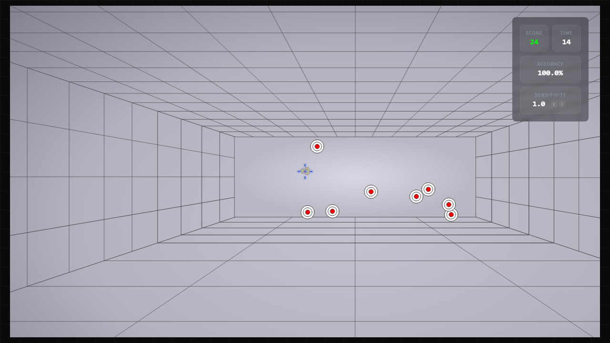
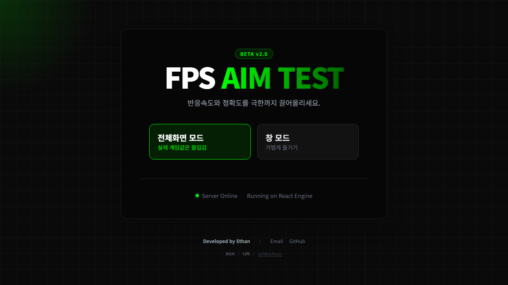
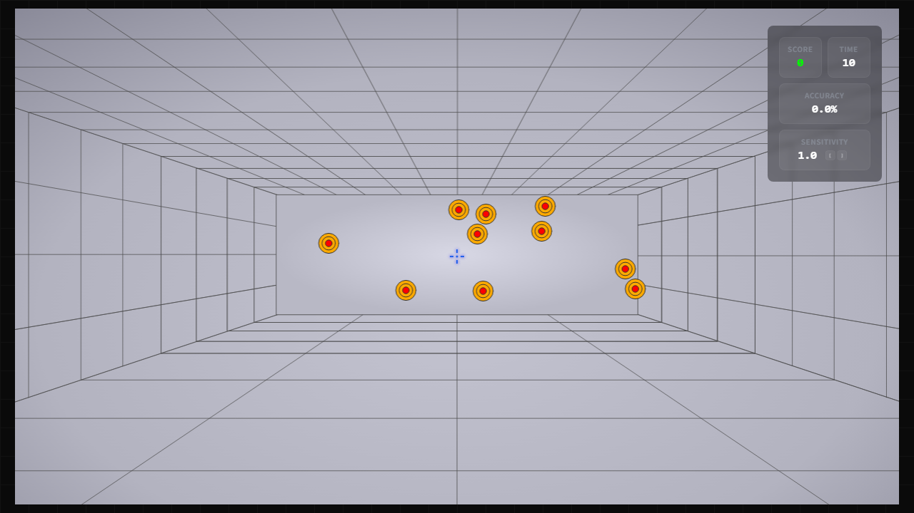
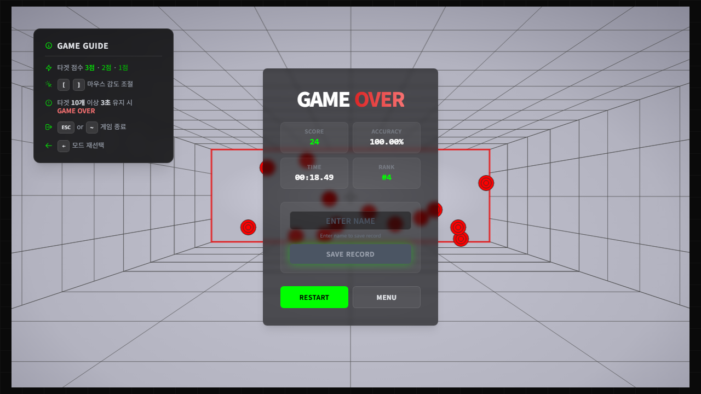
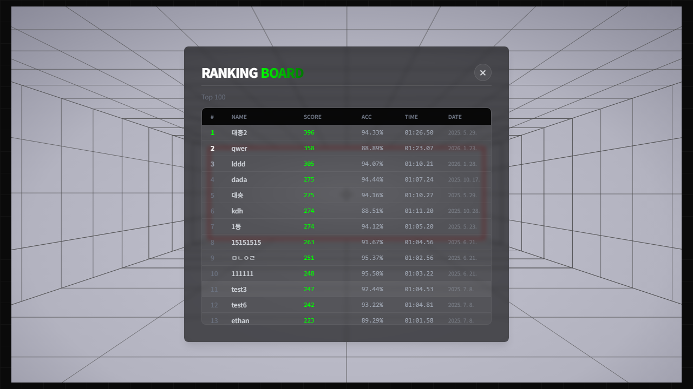

<div align="center">

# AimTest

Pointer Lock과 캔버스 rAF 루프 하나로 만든 브라우저 1인칭 에임 트레이너

**캔버스 단일 렌더 루프 · 입력 델타 큐잉 · state/ref 경계 · 랭킹 입력 검증**

[](https://github.com/Donghunn-Lee/aimtest/actions/workflows/ci.yml)      

[**Live**](https://fps-aim-test.vercel.app/) &nbsp;·&nbsp; [**Demo 영상**](https://vimeo.com/1159573198?share=copy&fl=sv&fe=ci) &nbsp;·&nbsp; 2025.03 – 2026.10 &nbsp;·&nbsp; 1인 개발

</div>



PC · 마우스 전용입니다. 모바일에서는 안내 화면만 나옵니다.

## 한눈에 보기

<table>
  <thead>
    <tr>
      <th nowrap>주제</th>
      <th>한 일</th>
      <th nowrap>설계 결정</th>
    </tr>
  </thead>
  <tbody>
    <tr>
      <td nowrap>렌더</td>
      <td>캔버스에 그리는 rAF를 하나로 모으고, 그리기는 순수 함수 렌더러에 위임. 종료는 복귀 애니메이션의 마지막 프레임을 그리고 정지</td>
      <td nowrap><a href="#1-캔버스-렌더-루프-단일화">1. 캔버스 렌더 루프 단일화</a></td>
    </tr>
    <tr>
      <td nowrap>시간</td>
      <td>스포너를 <code>setInterval</code>에서 rAF 누적시간 + 스톨 클램프로. 서버의 점수 개연성 검사도 이 스폰 간격에서 유도</td>
      <td nowrap><a href="#2-스포너를-raf-누적시간으로">2. 스포너를 rAF 누적시간으로</a></td>
    </tr>
    <tr>
      <td nowrap>구조</td>
      <td>587줄 <code>GameWorld</code>를 훅 11개로 분리. 허브는 조립만 하고, 훅이 반환하는 객체는 참조가 안정적</td>
      <td nowrap><a href="#3-gameworld-훅-분리-6단계">3. GameWorld 훅 분리 6단계</a></td>
    </tr>
    <tr>
      <td nowrap>경계</td>
      <td>프레임마다 바뀌는 값은 ref · 클래스에, React에는 UI 값만. 입력 델타는 큐잉, Pointer Lock은 raw input</td>
      <td nowrap><a href="#4-입력과-렌더의-경계">4. 입력과 렌더의 경계</a></td>
    </tr>
  </tbody>
</table>

## 주요 화면

<table>
  <tr>
    <td width="50%" align="center">
      <b>메인</b><br>
      서버 헬스체크 Online / Offline · 창 / 전체화면<br>
      
    </td>
    <td width="50%" align="center">
      <b>인게임</b><br>
      타겟 10개가 쌓이면 3초 유예, 색이 4단계로 바뀜<br>
      
    </td>
  </tr>
  <tr>
    <td width="50%" align="center">
      <b>결과</b><br>
      점수 · 정확도 · 시간, 이름 2 ~ 10자로 등록<br>
      
    </td>
    <td width="50%" align="center">
      <b>랭킹</b><br>
      상위 100 · 조회 실패 시 RETRY<br>
      
    </td>
  </tr>
</table>

겹침 제한(중심 거리 ≥ 반지름)으로 스폰되는 원형 타겟을 맞추면 중심 거리 3구간으로 1 ~ 3점을 얻습니다. 제한 시간은 없고, 타겟이 10개 쌓인 채 3초가 지나면 끝나는 서바이벌입니다. 감도는 `[` `]` 키로 0.1씩 바꾸고, ESC는 종료입니다.

## 배경

React 위에서 프레임 단위 제어를 어떻게 다루는지 보려고 만들었습니다. 입력 빈도와 렌더 빈도가 다르고, 매 프레임 바뀌는 값을 state로 돌리면 리렌더가 프레임을 따라갑니다. 어디까지를 React 밖(ref · 클래스 인스턴스)으로 빼고 무엇만 React에 남길지가 주제입니다. 카메라는 3D가 아니라 2D 맵 이미지 패닝이고, 랭킹은 익명입니다. 다음 프로젝트 [SlateKR](https://github.com/Donghunn-Lee/slate-kr)은 조회형 서비스 · 캐싱 · SEO 쪽을 다룹니다.

2025년 4 ~ 5월에 코어를 만들어 EC2 · Docker로 배포했고, 10월부터 이듬해 1월까지 렌더 루프 통합과 훅 분리를 했습니다. 2026년 10월 프리티어 만료로 EC2를 내리며 Vercel Functions + Neon으로 이전했고(데이터 미이관), 이어서 README를 코드와 대조하는 재정비를 6세션으로 진행해 CRA → Vite 8 · 테스트 · CI · API 입력 검증을 넣고 대조 중 발견한 결함을 고쳤습니다.

<sub>글 · [#20 EC2 + MySQL에서 Vercel + Neon으로](https://velog.io/@dh82680/AimTest-20-EC2-MySQL에서-Vercel-Neon으로) · [#21 재정비 시작 — README를 코드와 대조하기](https://velog.io/@dh82680/AimTest-21-재정비-시작-README를-코드와-대조하기)</sub>

## 아키텍처

```
mousemove ──▶ useInputController ──▶ loop.nudgeCamera()          pendingDeltaRef에 누적 (ref)
               (감도 곱)                        │
                                                ▼
                            useCanvasRenderLoop · frame()        캔버스에 그리는 rAF는 이것 하나
                              ├ pendingDelta 소비 · 카메라 clamp     (cameraRef)
                              ├ applyCameraTransform
                              ├ mapRenderer → targetRenderer → floatingScoreRenderer
                              └ targets = TargetManager.getTargets()   readonly, 복사 없음

mousedown ──▶ useInputController ──▶ TargetManager.checkHit() ──▶ gameActions   score · hitCount (React state)
spawner rAF (useTargetManager) ──▶ TargetManager.createTarget() ──▶ setTargetCount   스폰 성공 시에만
```

state와 ref의 경계가 기준입니다. 프레임마다 바뀌는 값(카메라 · 입력 델타 · 타겟 배열 · 테두리 opacity · 점수 이펙트)은 ref · 클래스 인스턴스에 살고, React state는 렌더가 필요한 UI 값(점수 · 경과시간 · 메뉴 · lock 여부 · 그레이스)만 가집니다. rAF · `setInterval` 콜백 안에서 프레임마다 `setState`하는 곳은 없습니다. 전역 상태 · Context도 없습니다.

```
src/
├── App.tsx                     메인 · 헬스체크 · 창 / 전체화면 · 모바일 안내
├── components/
│   ├── common/                 Button · GameModeButton · Icons · Key · PanelOverlay
│   └── game/
│       ├── core/GameWorld.tsx  훅 11개를 조립하는 런타임 허브 + 캔버스
│       ├── core/renderers/     map · target · floatingScore — 캔버스 드로잉 순수 함수
│       ├── core/target/        TargetManager.ts — 스폰 · 히트 · bounds 도메인 클래스
│       └── menu/  ranking/  settings/  ui/
├── hooks/                      커스텀 훅 11개
└── constants/  types/  utils/  services/
api/
├── index.ts                    Express 5 앱 — Vercel Function 하나
└── _lib/                       routes · controllers(validateRanking) · database(neon)
```

| 훅 | 역할 | 반환 |
|---|---|---|
| `useCanvasRenderLoop` | rAF 렌더 루프. start / stop 멱등, 입력 델타 누적 → 프레임 경계 반영, 카메라 클램프, 종료 시 원점 복귀 | 객체 (`useMemo`) |
| `useTargetManager` | `TargetManager` 어댑터. rAF 스폰 루프(누적시간 · 스톨 클램프). 타겟 배열은 인스턴스에, React에는 `targetCount`만 | `[state, actions]` |
| `useGame` | 게임 라이프사이클 · 점수 · 정확도 · 경과시간 · 그레이스 타이머 | `[state, actions]` |
| `useGameRuntime` | 경과시간 틱 · 스포너 시작/정지 · BGM · 테두리 페이드 · 유예 트리거를 effect로 묶음 | — |
| `useInputController` | mousemove → 감도 곱 → `nudgeCamera`, mousedown → 조준점 → `checkHit`, `[` `]` 감도 | 객체 |
| `usePointerLock` | 메인 캔버스만 잠금. `unadjustedMovement` 요청 + 폴백. 상태는 `pointerlockchange`로만 확정 | 객체 |
| `useResizeCanvas` | 모드 · 비율 기준 표시 크기, DPR 반영, resize는 rAF로 합침 | — |
| `useImageLoader` | 맵 이미지 로더. 모듈 캐시, `loading` / `error` 구분 | 객체 |
| `useVolume` | 효과음 단발 생성, BGM 단일 인스턴스 + 지연 재생 | `[state, actions]` |
| `useBorderFade` | 테두리 opacity를 ref로 페이드 | 객체 |
| `useFullscreen` | 전체화면 진입 · 해제 감지 | — |

| 랭킹 API | 응답 | 비고 |
|---|---|---|
| `GET /api/health` | 200 / 503 | `SELECT 1`. 메인 화면의 Online / Offline |
| `POST /api/rankings` | 201 / 400 `{ error }` | `user_name` trim 후 2 ~ 10자 · `score` 정수 0 ~ INT4 · `play_time` ≥ 0 · `accuracy` 0 ~ 100 · `score ≤ play_time × 10` |
| `GET /api/rankings` | 상위 100 | `ORDER BY score DESC LIMIT 100` |
| `GET /api/rankings/rank/:score` | `{ rank_position }` | `score` 정수 검증 |
| `GET /api/rankings/:userName` | 목록 | 클라이언트 미사용 |

### Tech Stack

| 영역 | 구성 |
|---|---|
| Frontend | React 19 · TypeScript 6.0 strict · Vite 8(rolldown) · Tailwind CSS 3.4 · framer-motion 12 · axios |
| Backend | Express 5 — `vercel.json` rewrite로 Vercel Function 하나 · `@neondatabase/serverless` · Neon PostgreSQL(`rankings` 테이블 하나) |
| Quality | Vitest 5 · ESLint 10 flat · Prettier · GitHub Actions · Node 24 |

## 설계 결정

### 1. 캔버스 렌더 루프 단일화

초기에는 렌더 루프와 별개로 타겟 렌더러 컴포넌트가 자체 rAF로 같은 캔버스 컨텍스트에 그렸습니다. 두 루프가 `save` · `restore` · `translate`를 서로 다른 시점에 호출해 컨텍스트의 상태 스택이 꼬였고, 타겟 색이 바뀌는 타이밍이 반복될 때마다 안티앨리어싱이 깨져 테두리가 점점 거칠어졌습니다. [`5fdd31f`](https://github.com/Donghunn-Lee/aimtest/commit/5fdd31f)에서 타겟 렌더러의 루프를 지우고 캔버스에 그리는 rAF를 `useCanvasRenderLoop` 하나로 모았습니다.

- 그리기는 `renderers/`의 순수 함수가 하고, 루프는 `GameWorld`가 `useMemo`로 묶은 `services`를 주입받아 clear → 카메라 변환 → map → targets → floatingScore → restore 순으로 호출합니다.
- `start` · `stop`은 멱등입니다. 종료는 `returnToOriginAndStop`이 복귀 애니메이션의 마지막 프레임 한 장을 그리고 멈춥니다. 원점이면 0ms입니다.
- 루프 재시작은 결과 화면을 벗어나는 전이(`isGameOver` true → false)에서만 일어납니다. 메뉴 → 게임 전이는 루프가 이미 돌고 있습니다.

README를 코드와 대조하던 중 결과 화면에서 루프가 되살아나는 경로를 둘 찾았습니다. 하나는 루프 반환 객체가 매 렌더 새 객체라 시작 effect가 리렌더마다 `stop` → `start`를 반복한 것으로, 반환 객체를 `useMemo`로 묶었습니다. 다른 하나는 종료 시 effect 순서(cleanup `stop` → 복귀 시작 → `start`) 탓에 카메라가 이미 원점이라 즉시 멈추는 경로에서 `start`가 루프를 되살린 것으로, 즉시 정지 분기를 없애 항상 복귀 애니메이션(원점이면 0ms)을 타게 하고 결과 화면에서는 시작 effect가 start도 stop도 하지 않게 했습니다.

<details>
<summary>결과 화면에서 루프를 멈춰 두는 이유</summary>

결과 화면은 카메라가 원점으로 돌아온 정지 화면이라 매 프레임 그릴 것이 없습니다. 대가로 결과 화면에서 창 너비를 바꾸면 리사이즈가 비운 캔버스를 다음 전이까지 다시 그리지 않습니다. 고치려면 `frame` 본문을 빼서 `redraw()`를 노출해야 하는데 몇 줄이 아니라고 보고 알려진 한계로 두었습니다.

</details>

<sub>코드 · [`useCanvasRenderLoop.ts` frame](https://github.com/Donghunn-Lee/aimtest/blob/400697a/src/hooks/useCanvasRenderLoop.ts#L154-L229) · [`returnToOriginAndStop`](https://github.com/Donghunn-Lee/aimtest/blob/400697a/src/hooks/useCanvasRenderLoop.ts#L281-L304) · [`GameWorld.tsx` services](https://github.com/Donghunn-Lee/aimtest/blob/400697a/src/components/game/core/GameWorld.tsx#L106-L127)</sub><br>
<sub>글 · [#10 렌더 루프 통합](https://velog.io/@dh82680/AimTest-10-렌더-루프-통합-시간축-합치기) · [#24 결과 창에서 살아나던 루프](https://velog.io/@dh82680/AimTest-24-마우스-점프와-결과-창에서-살아나던-루프)</sub>

### 2. 스포너를 rAF 누적시간으로

스폰 간격은 플레이 시간에 따라 줄어듭니다(1000ms × 0.982^초, 하한 330ms — 약 61초에 도달). `setInterval`로는 간격을 바꿀 때마다 타이머를 다시 걸어야 했습니다. [`b23dca2`](https://github.com/Donghunn-Lee/aimtest/commit/b23dca2)에서 rAF 틱마다 dt를 누적하고 그 시점의 간격으로 `while (accum >= interval)`을 돌려 스폰하는 구조로 바꿨습니다.

- 탭을 떠났다 돌아오면 dt가 수 초로 커져 스폰이 몰리므로 dt를 100ms로 클램프합니다.
- 스폰 성공 · 실패(겹침 제약 100회 시도)는 `TargetManager`가 판정하고, 성공했을 때만 `setTargetCount`를 부릅니다.
- 서버의 점수 검사 `score ≤ play_time × 10`은 이 최소 간격(330ms × 타겟당 3점 ≈ 9.1점/s)에서 나옵니다. 개연성 검사이지 조작 방지는 아닙니다(알려진 한계). 상수를 줄이면 서버 검증도 같이 봐야 해서 상수 옆에 적어 두었습니다.

<details>
<summary>나머지 타이머를 통합하지 않은 이유</summary>

경과시간 표시는 `setInterval` 100ms, 종료 유예는 `setTimeout` 3초, 테두리 페이드는 별도 rAF입니다. 핵심은 캔버스에 그리는 rAF가 하나라는 것이고, 그리지 않는 타이머를 합쳐서 얻는 이득은 확인되지 않았습니다. "모든 시간을 한 루프로"는 이 프로젝트의 주장이 아닙니다.

</details>

<sub>코드 · [`useTargetManager.ts` spawnerTick](https://github.com/Donghunn-Lee/aimtest/blob/400697a/src/hooks/useTargetManager.ts#L99-L128) · [`constants/target.ts` SPAWN](https://github.com/Donghunn-Lee/aimtest/blob/400697a/src/constants/target.ts#L7-L13) · [`TargetManager.ts` createTarget](https://github.com/Donghunn-Lee/aimtest/blob/400697a/src/components/game/core/target/TargetManager.ts#L43-L67)</sub><br>
<sub>글 · [#08 타겟 생성 로직 리팩토링 — 누적 프레임 루프](https://velog.io/@dh82680/AimTest-08-타겟-생성-로직-리펙토링-누적-프레임-루프)</sub>

### 3. GameWorld 훅 분리 6단계

`GameWorld`가 587줄에 렌더 · 리사이즈 · 포인터락 · 입력 · 전체화면 · 런타임 effect를 전부 들고 있었습니다. 책임 하나씩 훅으로 빼며 커밋을 나눴고, 587 → 531(렌더 루프) → 490(리사이즈) → 459(포인터락) → 395(입력) → 350(전체화면) → 312(런타임)로 줄었습니다. 지금은 JSDoc · 카메라 복귀 · 재정비 수정이 더해져 361줄이고, 허브는 훅을 조립하고 캔버스에 이벤트를 묶는 일만 합니다.

- 훅이 반환하는 객체 · 콜백은 참조가 안정적이어야 합니다. `useGame`의 actions, `useCanvasRenderLoop`의 반환 객체, `useTargetManager`의 state / actions는 `useMemo`이고 다른 훅의 effect deps에 들어갑니다.
- `useGameRuntime`이 경과시간 틱 · 스포너 · BGM · 페이드 · 유예 트리거 effect를 묶고, `GameWorld`에는 루프 시작 · 종료 · 레이아웃 effect만 남습니다.

README를 코드와 대조하던 중 인게임 TIME이 0에 고정된 것을 확인했습니다. `useGame`의 actions가 매 렌더 새 객체라 경과시간 `setInterval(…, 100)`이 리렌더마다 재생성됐고, 8ms마다 타겟 배열을 state로 복사하던 경로가 리렌더를 그보다 잦게 만들어 틱이 실행되기 전에 재생성됐습니다. actions를 `useMemo`로 묶고 8ms 복사 경로를 지워 렌더 루프가 `TargetManager`를 직접 읽게 했습니다. `GameWorld` 렌더는 12초에 약 670회에서 약 260회가 됐습니다.

<details>
<summary>전역 상태를 두지 않은 이유</summary>

상태는 `GameWorld`에서 2 ~ 3단 아래로만 내려가고(`volumeState → StartMenu → VolumeSlider`), 프레임 데이터는 어차피 React 밖에 있습니다. Context나 전역 스토어를 들일 자리가 없었습니다.

</details>

<sub>코드 · [`GameWorld.tsx` 훅 조립](https://github.com/Donghunn-Lee/aimtest/blob/400697a/src/components/game/core/GameWorld.tsx#L95-L254) · [`useGame.ts`](https://github.com/Donghunn-Lee/aimtest/blob/400697a/src/hooks/useGame.ts) · [`useGameRuntime.ts`](https://github.com/Donghunn-Lee/aimtest/blob/400697a/src/hooks/useGameRuntime.ts)</sub><br>
<sub>글 · [#14 600줄의 God Component 해체](https://velog.io/@dh82680/AimTest-14-600줄의-God-Component-해체-책임-분리와-Hub-패턴) · [#15 커스텀 훅 설계](https://velog.io/@dh82680/AimTest-15-커스텀-훅-설계-렌더링-루프와-상태-관리-중앙화) · [#23 멈춰 있던 TIME](https://velog.io/@dh82680/AimTest-23-멈춰-있던-TIME과-타겟-목록을-state로-돌리던-경로)</sub>

### 4. 입력과 렌더의 경계

`mousemove`는 렌더보다 잦고, 타겟 배열은 매 프레임 읽힙니다. 둘 다 React state로 돌리면 리렌더가 입력과 프레임을 따라가므로, 입력은 큐에 쌓아 프레임 경계에서 소비하고 타겟은 클래스 인스턴스에서 직접 읽습니다.

- 입력: `mousemove`마다 카메라를 옮기지 않고 감도를 곱한 델타를 `pendingDeltaRef`에 누적합니다. 다음 프레임에서 한 번에 소비하고 클램프합니다.
- 타겟: 배열은 `TargetManager` 안에만 있습니다. 렌더 루프는 `getTargets()`로 매 프레임 직접 읽고(복사 없음), React state는 유예 판정용 `targetCount` 하나뿐입니다. 스폰 성공 · 히트 · clear · init 시점에만 갱신합니다.
- Pointer Lock: `requestPointerLock({ unadjustedMovement: true })`를 먼저 시도하고 거부되면 옵션 없이 다시 요청합니다. Chrome(Windows)의 커서 재중앙화와 OS 가속이 겹쳐 생기던 점프가 왕복당 6.5회에서 0이 됐습니다.
- 좌표계는 CSS px로 통일했습니다. 캔버스 buffer만 DPR배이고, 카메라 · 클램프 · 타겟 영역은 전부 CSS px입니다.

재정비에서 함께 고친 것은 `onUnlock` 콜백의 ref화(effect deps에서 빠지며 `GameWorld` 렌더 262 → 142회), 경과시간 틱이 초가 바뀔 때만 state를 갱신하게 한 것(142 → 49회, 12초 기준 state 커밋 26회), 복귀 애니메이션 중 Menu를 누르면 새 루프가 멈추거나 다음 게임이 중간 위치에서 시작하던 것, 맵 로딩 레이스(`useEffect` → `useLayoutEffect`)입니다.

<details>
<summary>raw input을 택한 이유</summary>

`unadjustedMovement`는 OS 가속을 빼므로 같은 손 움직임에 플릭이 느려집니다. FPS 플레이어가 마우스 가속을 끄는 것과 같은 선택이라 기본 감도(1)는 그대로 두었고, 점프가 사라지는 쪽을 택했습니다.

</details>

<sub>코드 · [`useInputController.ts` onMouseMove](https://github.com/Donghunn-Lee/aimtest/blob/400697a/src/hooks/useInputController.ts#L74-L82) · [`useCanvasRenderLoop.ts` nudgeCamera](https://github.com/Donghunn-Lee/aimtest/blob/400697a/src/hooks/useCanvasRenderLoop.ts#L267-L272) · [델타 소비](https://github.com/Donghunn-Lee/aimtest/blob/400697a/src/hooks/useCanvasRenderLoop.ts#L156-L163) · [`usePointerLock.ts` request](https://github.com/Donghunn-Lee/aimtest/blob/400697a/src/hooks/usePointerLock.ts#L89-L112) · [`TargetManager.ts` getTargets](https://github.com/Donghunn-Lee/aimtest/blob/400697a/src/components/game/core/target/TargetManager.ts#L140-L143)</sub><br>
<sub>글 · [#05 타겟 매니저 클래스 설계](https://velog.io/@dh82680/AimTest-05-타겟-매니저-클래스-설계) · [#23 타겟 목록을 state로 돌리던 경로](https://velog.io/@dh82680/AimTest-23-멈춰-있던-TIME과-타겟-목록을-state로-돌리던-경로) · [#24 마우스 점프](https://velog.io/@dh82680/AimTest-24-마우스-점프와-결과-창에서-살아나던-루프)</sub>

## 품질

- 커밋 전 로컬에서 `npm run typecheck` · `lint` · `build` · `test -- --run`을 실행하고, CI(GitHub Actions)가 main push에서 같은 순서로 다시 실행합니다.
- TypeScript `strict`(web · api 둘 다) · `any` 0건. named export만 쓰고, default export는 Express 앱 하나입니다.
- ESLint 10 flat — `consistent-type-imports` · `no-import-type-side-effects` · `simple-import-sort` · `react-hooks` 2규칙 · Prettier(`prettier-plugin-tailwindcss`).
- 테스트는 순수 함수에 집중합니다. 74건 · 5파일 — 랭킹 입력 검증 32 · `TargetManager` 스폰 · 히트 16 · 유예 색상 · 스폰 간격 12 · 타겟 컨테이너 bounds 9 · 시간 포맷 5.
  - 시간 의존 함수는 시각을 인자로 받고, `Math.random`은 `vi.spyOn`으로 고정합니다.
- 랭킹 API 입력 검증 — 4필드 수동 검증, 실패는 `400 { error }`. SQL은 전부 `neon` 태그드 템플릿(파라미터화)입니다.
- 헬스체크 — 메인 화면 Online / Offline + RETRY, effect에 `AbortController` cleanup.
- knip — 미사용 export · 타입 · 의존성 0(api 엔트리는 설정 없이 미인식이라 제외). 1회 실행 기준이고 CI에는 없습니다.
- SEO · PWA 메타, 모바일 접속 시 PC 안내.

<sub>코드 · [`validateRanking.ts`](https://github.com/Donghunn-Lee/aimtest/blob/400697a/api/_lib/controllers/validateRanking.ts#L22-L71) · [`eslint.config.mjs`](https://github.com/Donghunn-Lee/aimtest/blob/400697a/eslint.config.mjs#L28-L45) · [`ci.yml`](https://github.com/Donghunn-Lee/aimtest/blob/400697a/.github/workflows/ci.yml)</sub><br>
<sub>글 · [#22 CRA에서 Vite로 — 툴체인 교체와 ESLint · CI](https://velog.io/@dh82680/AimTest-22-CRA에서-Vite로-툴체인-교체와-ESLint-CI) · [#25 랭킹 API 입력 검증과 코드를 닫기 전 점검](https://velog.io/@dh82680/AimTest-25-랭킹-API-입력-검증과-코드를-닫기-전-점검)</sub>

## 알려진 한계

**게임 · 렌더**

- Pointer Lock 첫 요청이 거부되면 게임은 시작된 채로 캔버스를 다시 클릭해야 잠기는데, 그 안내가 없습니다. 클릭 제스처에서는 보통 성공하고 자동화 · 거부 환경에서 재현됩니다.
- 게임 단계가 `isGameStarted` · `isGameOver` 두 boolean으로 표현되고, "복귀 중"이라는 단계는 렌더 루프 안의 ref에만 있습니다. 단계 전환은 effect 실행 순서에 기대며, 설계 결정 1의 루프 재시작 결함이 여기서 나왔습니다.
- 결과 화면에서 창 크기를 바꾸면 다음 전이까지 캔버스가 비어 있습니다.
- 볼륨 · 감도가 저장되지 않습니다.

**API · 품질**

- 점수 상한 `score ≤ play_time × 10`은 개연성 검사이지 조작 방지가 아닙니다. `play_time`도 클라이언트가 보내므로 함께 부풀리면 통과합니다. 막으려면 서버가 시작 시각을 발급해야 하고, 익명 리더보드의 인증 · rate limit과 함께 범위 밖입니다.
- 컴포넌트 · 훅 테스트가 없습니다. 훅이 반환하는 객체의 참조 동일성은 `renderHook` 재렌더로 검증할 수 있는데 아직 없고, 재정비 중의 검증은 Playwright로 렌더 횟수를 재는 방식이었습니다(스크립트는 저장소 밖). 루프 · Pointer Lock은 Canvas 모킹이 필요해 보류했습니다.
- 접근성 — 조준은 마우스 전용이라 대체 수단이 없습니다. 메뉴 · 랭킹의 키보드 탐색과 라벨은 점검하지 않았습니다.
- `react-hooks`의 React Compiler 규칙을 켜면 11건입니다 — rAF 콜백이 자기 자신을 재예약하는 패턴 충돌 2 · 로딩 상태를 effect에서 리셋하는 곳 4 · 렌더 중 `ref.current`를 읽는 곳 5(`GameWorld`가 `useImageLoader`에 넘기는 3 · 로더가 반환하는 2). 마지막 5건은 state/ref 경계 규칙의 예외이고, 고치려면 로더 구조를 바꿔야 합니다.
- `npm audit` 7건은 전부 Tailwind 3.4 경유 devDependency입니다. 실행 번들과 무관하고 v4 이전 전까지 유지합니다.

## 다시 한다면

둘 다 구조를 정할 때 기준에 없던 것이 뒤에서 비용이 된 경우입니다.

- 참조 안정성을 완료 기준에 넣습니다. 훅 분리는 줄 수로 완료 판정했고, 반환 객체가 effect deps에 들어간다는 점은 기준에 없었습니다. 그 결과가 TIME 고정과 리렌더마다 `stop` → `start`를 반복하던 루프였고, 둘 다 마무리가 아니라 재정비에서 찾았습니다. 지금도 이를 지키는 테스트는 없습니다 — 분리 커밋마다 반환 참조의 동일성을 확인하는 것이 다음 기준입니다. ([#23](https://velog.io/@dh82680/AimTest-23-멈춰-있던-TIME과-타겟-목록을-state로-돌리던-경로) · [#24](https://velog.io/@dh82680/AimTest-24-마우스-점프와-결과-창에서-살아나던-루프))
- 게임 단계를 상태 하나로 둡니다. 지금은 두 boolean에 "복귀 중"이 루프 안의 ref로 숨어 있고, 전환은 effect 실행 순서로 조율됩니다. 결과 화면에서 되살아나던 루프, 복귀 중 Menu 전이의 결함이 전부 이 구조에서 나왔습니다. menu → playing → returning → result를 상태 하나로 두고 루프의 `start` · `stop`을 전환 시점에 직접 부르면, effect 순서에 기대는 자리가 사라집니다. ([#24](https://velog.io/@dh82680/AimTest-24-마우스-점프와-결과-창에서-살아나던-루프))

<sub>글 · [#18 프로젝트 회고](https://velog.io/@dh82680/AimTest-18-프로젝트-회고-종결-이후-다시-잡은-프로젝트) · [시리즈 25편](https://velog.io/@dh82680/series/Aim-Tester)</sub>

## 로컬 실행

검증만이면 DB 없이 됩니다. Node 24가 필요합니다.

```bash
npm install
npm run typecheck && npm run lint && npm run build && npm run test -- --run
```

앱 실행은 `.env.local`에 Neon `DATABASE_URL`을 넣고 Neon SQL Editor에서 `init.sql`을 적용한 뒤 `npx vercel dev`입니다. 랭킹 없이 플레이만 보려면 [Live](https://fps-aim-test.vercel.app/)가 빠릅니다.

## Author

- 이동훈 (Donghunn Lee) · Frontend Developer
- GitHub: https://github.com/Donghunn-Lee
- Email: [dh82680@gmail.com](mailto:dh82680@gmail.com)

## Credits · License

- BGM: 니아 / [SellBuyMusic](https://sellbuymusic.com/md/mqqtckh-dffhnkh)
- 코드는 [MIT](LICENSE)입니다. BGM · 효과음 · 맵 이미지는 제외합니다.
